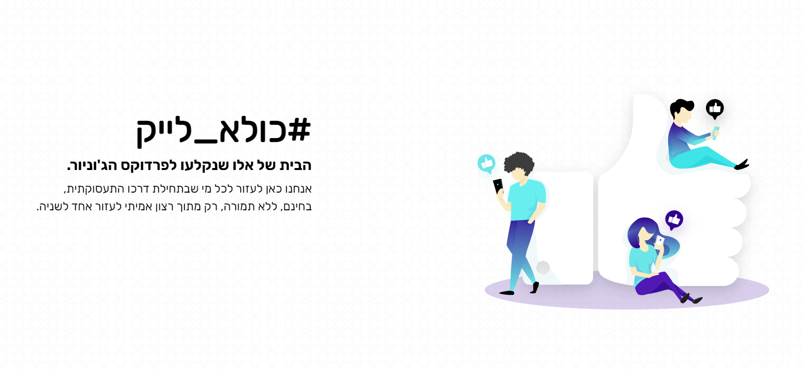

# coola like (#כולא_לייק)

Community platform for **#כולא_לייק**, a volunteer community of about 9,000 members that helps junior developers get their first job in tech.



## Features

- **Jobs board** with search by role and location, focused on junior positions.
- **Events** page for community meetups, workshops and hackathons, with an admin view for managing them.
- **Projects and tasks** management for community projects, including task assignment and progress statistics.
- **User profiles** with social login (Google, LinkedIn, Facebook).

## Tech stack

- **Front-end:** React 17, Redux Toolkit, React Router, Material UI, Ant Design, styled-components, Sass
- **Charts:** Chart.js, Recharts
- **Back-end:** Node.js REST API, developed by a separate team in the project
- **Tools:** Figma (UI/UX), Postman, Git, GitHub Pages

## My role

I was the **lead front-end developer** in a volunteer team of about 10 developers and 2 UI/UX designers. I planned the front-end architecture, worked with the designers in Figma and coordinated the API contract with the back-end team.

## Running locally

```bash
git clone https://github.com/avraham186/coola-like.git
cd coola-like
npm install
cp .env.example .env   # then fill in the API URL and OAuth client IDs
npm start
```

The app runs at http://localhost:3000.

> **Note:** the original back-end was hosted on Heroku's free tier, which has since been discontinued, so the live demo currently loads without data.

## Team

**UI/UX:** Lena, Chen Perry
**Developers:** Alexander Lazarovich, Avraham Kuperwasser, Gabriel, Ori, Adi, Michael, Elyashiv, Tal, Yuval
